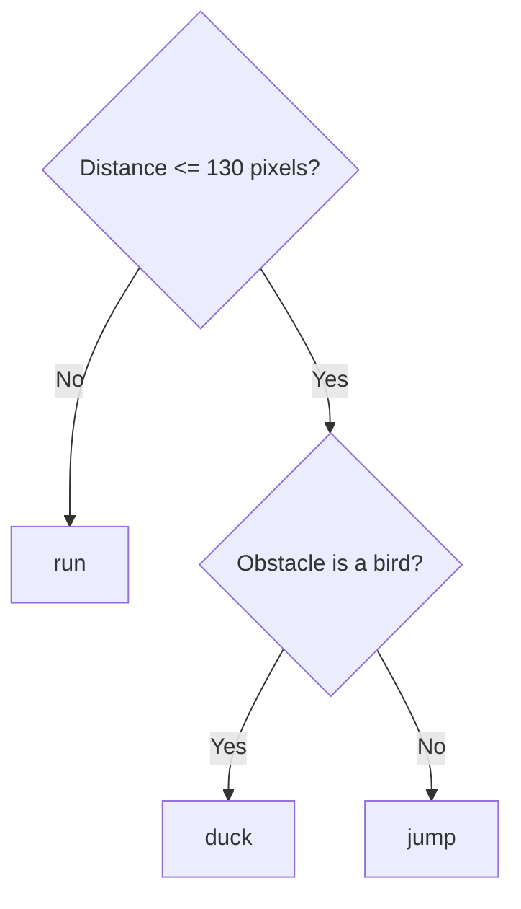

<!-- Project title -->
# T-Rex Decision Tree Bot

<!-- Project cover -->


<!-- Relevant project badges -->
[](./LICENSE)
[](https://www.python.org/)
[](https://developer.mozilla.org/en-US/docs/Web/JavaScript)
[](https://scikit-learn.org/)

## Table of Contents

- [T-Rex Decision Tree Bot](#t-rex-decision-tree-bot)
  - [Table of Contents](#table-of-contents)
  - [Introduction](#introduction)
  - [Technologies Used](#technologies-used)
  - [Decision Tree Concepts](#decision-tree-concepts)
  - [Mathematical Formulas](#mathematical-formulas)
  - [Simple Example: Two Inputs and Three Actions](#simple-example-two-inputs-and-three-actions)
  - [How to Run the Project](#how-to-run-the-project)
  - [How to Record Training Data](#how-to-record-training-data)
  - [How to Train a Model](#how-to-train-a-model)
  - [How to Use Your Trained Model](#how-to-use-your-trained-model)
  - [Project Structure](#project-structure)
  - [Verification](#verification)
  - [References](#references)
  - [License](#license)

## Introduction

T-Rex Decision Tree Bot learns to play the Chrome dinosaur game by imitating recorded human commands. You play the game, export observations as CSV files, train a decision tree in Python, and load the exported model into the browser to control the dinosaur automatically.

The model predicts one of three actions:

| Action | Behavior |
| --- | --- |
| `run` | Release jump and duck commands; keep running or continue an ongoing jump. |
| `jump` | Hold the jump command; start a jump when on the ground. |
| `duck` | Crouch on the ground or accelerate the fall while airborne. |

This is a supervised learning project: the labels come from your demonstrations. The model does not learn through rewards or improve itself while playing. It can reproduce mistakes in the recordings, and high prediction accuracy does not guarantee a long game.

A trained example is included in [`examples/trained-model/`](examples/trained-model/), so you can try the bot before collecting data or installing Python dependencies.

The browser game is based on [wayou/t-rex-runner](https://github.com/wayou/t-rex-runner), extracted from Chromium's offline game. Original license notices are preserved.

## Technologies Used

&nbsp;
&nbsp;
&nbsp;
&nbsp;
&nbsp;

| Technology | Role |
| --- | --- |
| HTML, CSS and JavaScript | Browser game, recording controls and automatic player. |
| Python and scikit-learn | Data preparation, feature encoding, tree training and validation. |
| Tkinter | Local graphical training interface. |
| Matplotlib | PNG previews and complete SVG tree diagrams. |
| Pillow | Diagram preview and zoom in the training interface. |
| joblib | Save the Python model and its feature encoder. |
| JSON | Transfer the trained tree to the browser. |
| Node.js and Python unittest | Automated verification; Node.js is not required to play. |

## Decision Tree Concepts

A classification decision tree makes a prediction by following a sequence of questions about its inputs. Training discovers which questions best separate the labeled examples.

| Concept | Meaning in this project |
| --- | --- |
| Sample | One recorded game observation and the human command associated with it. |
| Feature | An input such as speed, obstacle distance, obstacle type or whether the dinosaur is jumping. |
| Label / class | The action to predict: `run`, `duck` or `jump`. |
| Root | The first question evaluated for every prediction. |
| Decision node | A comparison such as `obstacle_distance <= 100`. |
| Branch | The path selected according to whether the comparison is true or false. |
| Leaf | A terminal node that supplies the predicted action. |
| Impurity | How mixed the action classes are within a node. A node containing one class is pure. |
| Depth | The number of splits between the root and a node. More depth allows more detailed rules. |
| Overfitting | Learning details of the training recordings that do not generalize to new gameplay. |
| Validation | Evaluating candidate models on samples withheld from their fitting step. |

In this implementation, categorical obstacle types are encoded using `DictVectorizer`. The tree then splits numerical features or encoded category indicators. No feature scaling is required by the training pipeline.

The trainer excludes `action`, `jump_pressed` and `duck_pressed` from the inputs because they reveal the target command. It also excludes identifiers, elapsed time, total distance, `source` and `terminal`. Collision samples and the sample immediately before each collision in the same segment are discarded. Missing obstacle measurements become `-1`.

The final model is limited to 128 leaves. The requested maximum depth defaults to 16 and must be between 1 and 24. These limits constrain tree growth; they do not guarantee good generalization.

## Mathematical Formulas

The project uses `DecisionTreeClassifier` with its default **Gini impurity** criterion, balanced class weights and `random_state=42`. The following formulas describe its splits and the validation score used by this repository. See the official [classifier reference](https://scikit-learn.org/stable/modules/generated/sklearn.tree.DecisionTreeClassifier.html) for parameter definitions.

### 1. Balanced class weights

Let $N$ be the number of fitting samples, $K$ the number of classes present, and $N_k$ the number of samples belonging to class $k$. Each sample of class $k$ receives weight:

$$
w_k = \frac{N}{K N_k}
$$

This gives rare actions more weight during fitting. Weights are calculated from each candidate's training subset, then recalculated from all valid samples for the final fit.

For a node $S$, define its total weight and weighted class proportions as:

$$
W(S) = \sum_{i \in S} w_{y_i}
\qquad
p_k(S) = \frac{\sum_{i \in S} w_{y_i}\,\mathbf{1}[y_i=k]}{W(S)}
$$

Here, $y_i$ is the recorded action, and $\mathbf{1}[y_i=k]$ is 1 when that action is class $k$, otherwise 0.

### 2. Gini impurity

$$
G(S) = 1 - \sum_{k=1}^{K} p_k(S)^2
$$

A pure node has $G(S)=0$. With three equally represented actions, its impurity is $1-3(1/3)^2=2/3$.

### 3. Split quality

A candidate feature $j$ and threshold $t$ divide a node into:

$$
S_L = \{i \in S : x_{ij} \leq t\}
\qquad
S_R = \{i \in S : x_{ij} > t\}
$$

The weighted impurity after the split is:

$$
G_{\mathrm{split}} = \frac{W(S_L)}{W(S)}G(S_L) + \frac{W(S_R)}{W(S)}G(S_R)
$$

Its local impurity reduction is:

$$
\Delta G = G(S) - G_{\mathrm{split}}
$$

The tree favors splits that reduce impurity. The decrease relative to the full fitting dataset $D$ is $\frac{W(S)}{W(D)}\Delta G$. See scikit-learn's [mathematical formulation](https://scikit-learn.org/stable/modules/tree.html#mathematical-formulation).

### 4. Leaf prediction

Once an observation reaches leaf $L$, the prediction is the class with the largest weighted proportion:

$$
\hat{y} = \operatorname*{arg\,max}_{k} p_k(L)
$$

### 5. Model selection: macro F1

The repository compares candidate depths by validation macro F1. For action $k$, $TP_k$, $FP_k$ and $FN_k$ count true positives, false positives and false negatives:

$$
F1_k = \frac{2TP_k}{2TP_k+FP_k+FN_k}
\qquad
F1_{\mathrm{macro}} = \frac{1}{K}\sum_{k=1}^{K} F1_k
$$

A zero denominator is assigned a score of zero. Each action contributes equally to the average. The highest score wins; ties within the code's tolerance favor the shallower tree. Accuracy is also reported:

$$
\mathrm{Accuracy} = \frac{\text{correct predictions}}{\text{validation samples}}
$$

Macro F1 selects the depth; Gini impurity selects splits within each tree. They serve different steps of training.

## Simple Example: Two Inputs and Three Actions

Consider six illustrative observations with only two inputs: obstacle distance in pixels and obstacle type. The answer is one of three actions.

| Distance | Obstacle type | Action |
| ---: | --- | --- |
| 200 | Cactus | `run` |
| 250 | Bird | `run` |
| 40 | Cactus | `jump` |
| 60 | Cactus | `jump` |
| 40 | Bird | `duck` |
| 60 | Bird | `duck` |

One tree that classifies these examples is:



The threshold 130 lies halfway between the neighboring distances 60 and 200. Initially, each action has two samples, so all class weights are 1 and the root's Gini impurity is $2/3$.

The distance split creates a pure `run` group with two samples and a group with two `jump` and two `duck` samples:

$$
G_{\mathrm{split}} = \frac{2}{6}(0)+\frac{4}{6}\left(1-\left(\frac{2}{4}\right)^2-\left(\frac{2}{4}\right)^2\right)=\frac{1}{3}
$$

The impurity reduction is $2/3-1/3=1/3$. Splitting the nearby obstacles by type then creates two pure leaves.

For a cactus at 50 pixels, follow **Yes → No → jump**. For a bird at 50 pixels, follow **Yes → Yes → duck**. At 220 pixels, follow **No → run**.

This is a teaching example, not the complete training CSV schema or a reliable gameplay strategy. The real model also receives speed, dinosaur state, obstacle height and other measurements. Bird height and jump timing affect which action is appropriate, and an equally good training split may produce another tree.

## How to Run the Project

### Clone the repository

```sh
git clone https://github.com/Maykon-JDS/trex-decision-tree-bot.git
cd trex-decision-tree-bot
```

### Try the included model

1. Open the hosted game in a modern browser, or serve it locally as described below.
2. In **Autoplayer**, click **Default model** to load the included trained tree.
3. Click **Enable autoplayer**. The game starts automatically.
4. Press **Esc** or click **Disable autoplayer** to return to manual control.

To use a custom model, click **Load model…** and choose its JSON file. When opening `index.html` directly from disk, use this file picker to select `examples/trained-model/model.json`; the **Default model** button requires the hosted page or a local HTTP server.

After a collision, enable the autoplayer again to start another game. Switching tabs pauses the game. Manual recording is disabled while the bot plays.

No Python installation or server is needed for this browser-only workflow. If you prefer a local HTTP server and have Python installed:

```sh
python -m http.server 8000
```

Open [http://localhost:8000](http://localhost:8000).

The example model was trained on 1,756 samples: 1,540 `run`, 211 `jump` and only 5 `duck`. Its [report](examples/trained-model/report.txt) includes validation metrics and their limitations.

## How to Record Training Data

1. Open the game and keep the autoplayer disabled.
2. Click **Start recording**.
3. Press Space to start. Use Space or ↑ to jump and ↓ to duck or fall faster.
4. Play multiple games and demonstrate all three actions. Recording continues across restarts.
5. Click **Stop recording**, then **Download CSV**.

Recording captures game states and commands, not video. Periodic samples are collected before physics updates at most once every 50 ms; input changes add immediate observations. Data stays in the current tab's memory, so download it before refreshing or closing the page. Downloading does not clear it; avoid combining overlapping exports from the same recording.

Keep the exported columns intact. See [RECORDING.md](RECORDING.md) for the complete CSV schema.

## How to Train a Model

### Install training dependencies

Python with `venv`, pip and Tkinter is needed for the graphical workflow. The commands below assume Python 3.12. On some Linux distributions, Tkinter must be installed separately using the operating system's package manager.

**Windows PowerShell:**

```powershell
python -m venv .venv
.\.venv\Scripts\python.exe -m pip install -r requirements.txt
```

**macOS / Linux:**

```sh
python3 -m venv .venv
.venv/bin/python -m pip install -r requirements.txt
```

### Train using the graphical interface

On Windows, double-click `open_training.bat` after installing the environment. Alternatively, launch it explicitly:

```powershell
.\.venv\Scripts\python.exe training_app.py
```

On macOS / Linux:

```sh
.venv/bin/python training_app.py
```

1. Click **Import CSV…** and select one or more recordings.
2. Check the **CSV preview** tab.
3. Choose **Maximum depth**, from 1 to 24; the default is 16.
4. Click **Train and draw tree**.
5. Inspect the **Decision tree** and **Report** tabs. **Full tree (SVG)** opens the complete diagram; the PNG preview is limited to 6 levels for deeper trees.
6. Note the output directory shown when training finishes. Graphical training saves each run under `results/<timestamp>/`.

### Train using the terminal

**Windows PowerShell:**

```powershell
.\.venv\Scripts\python.exe train_tree.py "C:\path\trex-games.csv" --depth 16 --output results/my-model --no-window
```

**macOS / Linux:**

```sh
.venv/bin/python train_tree.py /path/to/trex-games.csv --depth 16 --output results/my-model --no-window
```

Pass multiple CSV paths before the options to combine recordings. `--no-window` saves diagrams without opening a plot window; `--output` chooses the destination.

### Understand the training results

Training requires at least two different action labels. To learn all three actions, all three must appear in the valid data.

With at least 15 valid samples and at least two samples of each present class, the trainer uses a stratified validation split of approximately 20%. It compares depths 2, 4, 6, 8, 12, 16, 20 and 24 up to your limit, including the limit itself. With insufficient data, it uses your limit without reporting invented validation scores. The selected tree is then fitted again on all valid samples.

Validation is used for depth selection, so it is not an independent final test. Samples from the same games can appear on both sides of the split; nearby observations can make metrics optimistic. Evaluate gameplay on fresh attempts as well as checking the report.

| Output | Purpose |
| --- | --- |
| `model.json` | Load the tree into the browser autoplayer. |
| `model.joblib` | Python model, encoder and training metadata. |
| `tree.png` | Diagram preview. |
| `tree.svg` | Complete decision tree. |
| `report.txt` | Class counts, depth selection and classification metrics. |
| `depth_comparison.csv` | Validation scores for candidate depths. |
| `labeled_data.csv` | Training samples with their labels and predictions. |

See [TRAINING.md](TRAINING.md) for more detail.

## How to Use Your Trained Model

1. Open `index.html` or click **Open game** in the training interface.
2. Click **Load model…** in the **Autoplayer** section.
3. Select `model.json` from your training output directory.
4. Click **Enable autoplayer**.

The browser evaluates the exported tree approximately every 50 ms. Python is not required during gameplay. Use **Esc** to resume manual control.

To export an existing action model again without retraining:

```powershell
.\.venv\Scripts\python.exe export_model.py "results\my-model\model.joblib"
```

On macOS / Linux, use `.venv/bin/python` instead of the Windows interpreter path. This creates `model.json` next to the saved Python model.

## Project Structure

```text
.
├── assets/                    # Game sprites and preview images
├── examples/trained-model/    # Included trained model and report
├── tests/                     # Python, JavaScript and browser checks
├── index.html                 # Game page and recording/autoplay controls
├── index.css                  # Page styles
├── index.js                   # Original game engine and integration hooks
├── game-state.js              # Features shared by recording and inference
├── recorder.js                # Gameplay recording and CSV export
├── tree-model.js              # Exported model validation and prediction
├── autoplayer.js              # Apply predicted actions to the game
├── train_tree.py              # Training, validation and diagram generation
├── training_app.py            # Graphical training interface
├── export_model.py            # Python-to-JSON model export
├── open_training.bat          # Windows graphical launcher
├── requirements.txt           # Python dependencies
├── RECORDING.md               # Recording guide and CSV schema
├── TRAINING.md                # Detailed training guide
└── LICENSE                    # BSD 3-Clause license
```

Local environments and generated training outputs are excluded by `.gitignore`.

## Verification

With Node.js installed, run the JavaScript tests:

```sh
node --test tests/autoplayer.test.cjs tests/recorder.test.cjs
```

Run the Python tests after installing training dependencies. Node.js must also be available because the export tests compare Python and JavaScript predictions:

```powershell
.\.venv\Scripts\python.exe -m unittest discover -s tests -p "test_*.py"
```

On macOS / Linux, substitute `.venv/bin/python` for the interpreter path.

An optional browser integration check loads a model and exercises automatic play:

```sh
node tests/browser-smoke.cjs examples/trained-model/model.json
```

To verify the **Default model** button over HTTP under a project subdirectory, add `--default`:

```sh
node tests/browser-smoke.cjs examples/trained-model/model.json --default
```

The browser check requires a Node.js version providing global `fetch` and `WebSocket` (such as Node.js 22+) and Chrome. It defaults to the standard Windows Chrome installation path; set `CHROME_PATH` for another installation. The check writes its screenshot to `.venv/autoplay-smoke.png`, so create the environment directory first.

## References

- [scikit-learn: Decision trees and mathematical formulation](https://scikit-learn.org/stable/modules/tree.html#mathematical-formulation)
- [scikit-learn: DecisionTreeClassifier](https://scikit-learn.org/stable/modules/generated/sklearn.tree.DecisionTreeClassifier.html)
- [scikit-learn: F1 score](https://scikit-learn.org/stable/modules/generated/sklearn.metrics.f1_score.html)
- [Original T-Rex Runner repository](https://github.com/wayou/t-rex-runner)

## License

This project includes code distributed under the [BSD 3-Clause License](./LICENSE). See [LICENSE](./LICENSE) for its terms and the original copyright notice.
